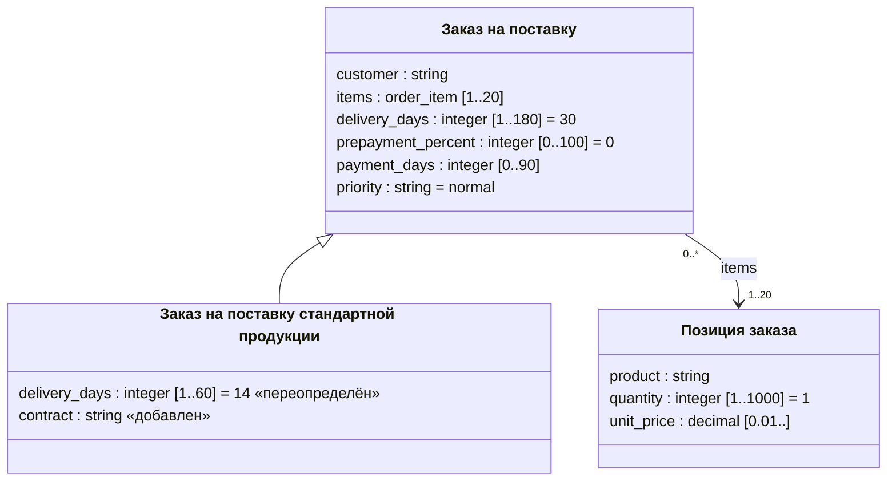
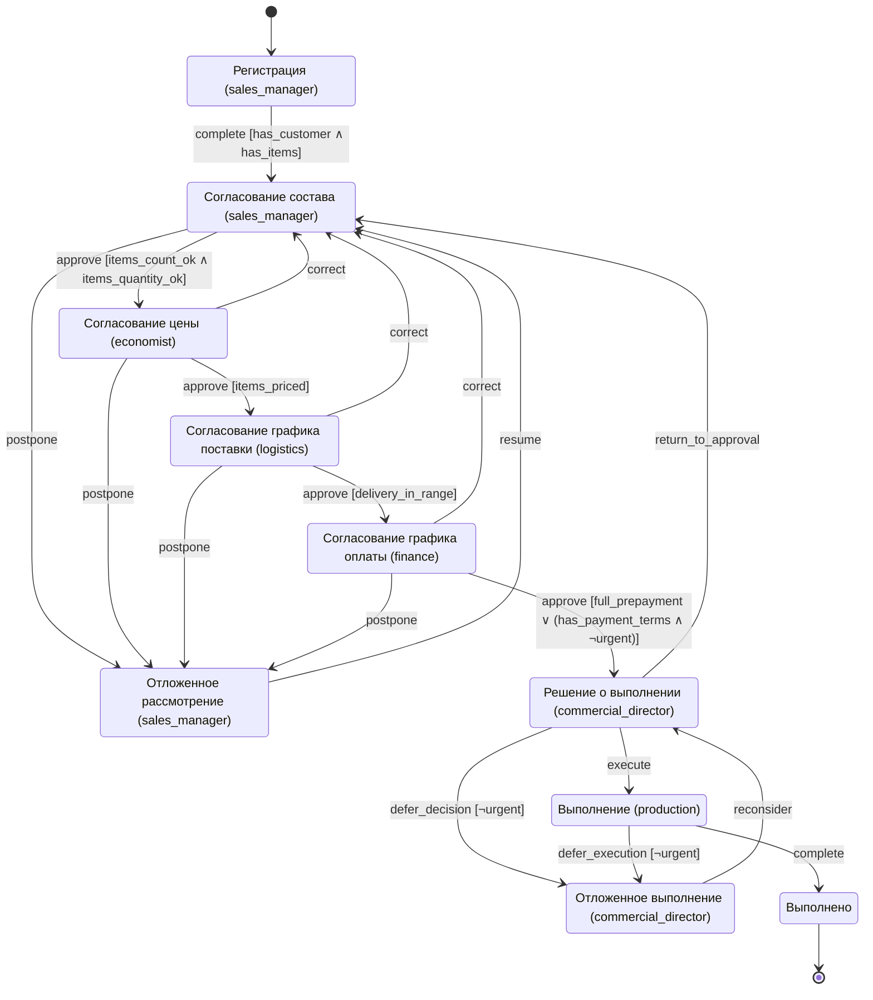

# Вариант 3. Управление заказом на поставку стандартной продукции

Конфигурация лежит в `examples/variant3/`: классы (`classes.yaml`), готовые объекты (`objects.yaml`), роли и пользователи (`users.yaml`), шаблон процесса (`supply_order.yaml`), сценарий демонстрации (`demo.txt`). Тесты — `tests/test_variant3.py`.

Процесс выполняется над **заказом на поставку стандартной продукции**. Заказ последовательно согласуют:
1. менеджер по продажам — состав заказа;
2. экономист — цену;
3. логистика — срок поставки;
4. финансовая служба — оплату.

После согласований коммерческий директор принимает решение о выполнении, и производство выполняет заказ. С этапов согласования заказ можно вернуть на коррекцию состава или отложить. Состояния и переходы взяты с рис. 3 задания. Роли и условия разработаны бригадой и согласованы с преподавателем.

## Механизмы объектной модели

Реализованы оба механизма.

- **Наследование.** Базовый класс «Заказ на поставку» (`supply_order`), подкласс «Заказ на поставку стандартной продукции» (`standard_order`).
  - Подкласс наследует параметры базового класса.
  - Он **переопределяет** `delivery_days`: срок 1..60 дней вместо 1..180, значение по умолчанию 14 вместо 30.
  - Он **добавляет** параметр `contract`.
  - Шаблон процесса привязан непосредственно к подклассу. У базового класса шаблона нет: шаблоны не наследуются.
- **Составность.** Параметр-состав `items` класса `order_item` — ссылки на позиции заказа, от 1 до 20.
  - Условия проверяют параметры каждой позиции через путь и агрегатор `all`.
  - `items.quantity in_range` — количество каждой позиции в диапазоне её класса.
  - `items.unit_price filled` — у каждой позиции назначена цена.

## Готовые объекты

| Объект | Класс | Назначение |
|---|---|---|
| `item-bolt`, `item-nut`, `item-washer` | order_item | позиции основного заказа; у `item-washer` количество по умолчанию 1 |
| `item-unpriced` | order_item | позиция без цены |
| `item-too-many` | order_item | 5000 шт. при максимуме 1000 |
| **`ord-1`** | standard_order | **основной объект демонстрации**: проходит весь маршрут |
| `ord-default-delivery` | standard_order | срок не указан, подставляется default подкласса 14 |
| `ord-long-delivery` | standard_order | 90 дней: базовому классу можно, стандартному нельзя |
| `ord-bad-quantity` | standard_order | позиция с количеством вне диапазона |
| `ord-unpriced` | standard_order | позиция без цены |
| `ord-empty` | standard_order | без позиций |
| `ord-urgent` | standard_order | срочный с полной предоплатой |
| `ord-urgent-credit` | standard_order | срочный в кредит |
| `ord-no-terms` | standard_order | отсрочка явно `null`, предоплаты нет |
| `base-order` | supply_order | объект базового класса: шаблона нет, запуск отклоняется |

## Роли

Роли назначены по этапам диаграммы.

| Роль | Состояния | Пользователь |
|---|---|---|
| sales_manager — Менеджер по продажам | запуск процесса; Регистрация, Согласование состава, Отложенное рассмотрение | smirnova |
| economist — Планово-экономический отдел | Согласование цены | kozlov |
| logistics — Отдел логистики | Согласование графика поставки | popova |
| finance — Финансовый отдел | Согласование графика оплаты | volkov, morozov |
| commercial_director — Коммерческий директор | Решение о выполнении, Отложенное выполнение | morozov |
| production — Производство и склад | Выполнение | lebedev |

## Диаграмма состояний с условиями

## Предикаты и условия

| Предикат | Определение | Что показывает |
|---|---|---|
| `has_customer` | `customer filled` | |
| `has_items` | `items filled` | состав не пуст |
| `items_count_ok` | `items in_range` | число позиций 1..20 (`quantity_min/max`) |
| `items_quantity_ok` | `items.quantity in_range`, `aggregate: all` | **путь + агрегатор**, диапазон класса позиции |
| `items_priced` | `items.unit_price filled`, `aggregate: all` | **путь + агрегатор** |
| `delivery_in_range` | `delivery_days in_range` | **проверка диапазона**, переопределённого в подклассе |
| `full_prepayment` | `prepayment_percent = 100` | |
| `has_payment_terms` | `payment_days filled` | |
| `urgent` | `priority = urgent` | |

| Переход | Условие (ДНФ) |
|---|---|
| Регистрация → Согласование состава | `[has_customer, has_items]` — **«И»** |
| Состав → Цена | `[items_count_ok, items_quantity_ok]` |
| Цена → График поставки | `[items_priced]` |
| График поставки → График оплаты | `[delivery_in_range]` |
| График оплаты → Решение | `[full_prepayment]` **«ИЛИ»** `[has_payment_terms, not urgent]` — **отрицание** |
| Решение → Отложенное выполнение; Выполнение → Отложенное выполнение | `[not urgent]` — срочный заказ откладывать нельзя |

В этом шаблоне каждой паре «состояние, действие» соответствует ровно один переход, поэтому неоднозначности не возникает. Неоднозначный переход проверяется на специально подготовленном шаблоне: `tests/test_engine.py::test_ambiguous_transition_is_error_and_keeps_state`.

## Сценарий демонстрации (`demo.txt`)

Один шаблон и один экземпляр процесса над `ord-1`. Сценарий проходит основной маршрут до «Выполнено» и включает:
- отказ при запуске пользователем без роли `sales_manager`;
- отказ логисту (`popova`) на согласовании цены: нужна роль `economist`;
- **возврат** «коррекция» с графика поставки на согласование состава;
- отказ после завершения процесса.

После основного маршрута в сценарии идёт отдельный запуск над `ord-long-delivery`, где переход отклоняется по условию `delivery_in_range`. Последние две строки показывают некорректную команду (ошибка в журнале) и объект базового класса без шаблона.

## Тесты — обязательный минимум раздела 4

| Требование | Тест |
|---|---|
| запуск и основной маршрут до конечного состояния | `test_main_route_to_final_state` |
| возврат на предыдущий этап | `test_return_to_previous_stage`, `test_other_returns` |
| отказ без необходимой роли | `test_no_role_to_start`, `test_no_role_for_action` |
| отказ при невыполненном условии | `test_registration_needs_customer_and_items`, `test_payment_negation_urgent_on_credit`, `test_payment_unset_terms` |
| наследование и переопределение | `test_overridden_range_rejects_long_delivery`, `test_inherited_default_of_subclass`, `test_template_bound_to_subclass_only` |
| составность с агрегатором | `test_composition_quantity_all_rejects`, `test_composition_price_all_rejects`, `test_aggregate_chosen_from_configuration` |
| журнал успехов и отказов; отказ не меняет состояние | `test_log_has_success_and_rejections` и проверки журнала в каждом тесте |
